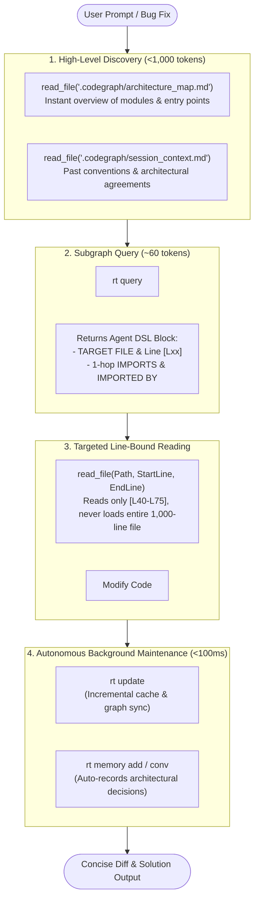

# ReduceToken

**English** | **[Tiếng Việt](README_VI.md)**

A lightweight, autonomous Code Knowledge Graph and Persistent Session Memory for AI coding agents, following the [Agent Skills](https://agentskills.io) open standard. Compatible with **Google Antigravity**, **Cursor IDE**, **Claude Code**, **OpenCode**, **Codex**, and **GitHub Copilot**.

[](LICENSE)
[](https://www.python.org/)
[](https://docs.python.org/3/library/)
[](https://agentskills.io)
[](https://modelcontextprotocol.io)
[](#-token-economics-before-vs-after)

> **Eliminates context window bloat, stops wasteful full-directory scans (`ls -R`, indiscriminate file reading), and cuts token consumption by up to 95%.**

---

## ⚡ Quick Start

> **Choose ONE of the two options below (You do NOT need to do both):**

### 🌟 Option A: Smart Multi-Agent Installer (Recommended)
Installs the `rt` CLI and auto-detects which AI coding agents are present on your machine:

```bash
# 1. Install CLI from Git
pip install git+https://github.com/TuilaTammmmm/ReduceToken.git

# 2. Run smart installer (Auto-detects and lets you pick target agents or install all)
rt install
```

**Interactive Selector Preview:**
```text
Detected AI environments on your system:
  [1] Google Antigravity & Gemini CLI        [DETECTED]
  [2] Cursor IDE (Global MCP)                [DETECTED]
  [3] Claude Code                            [DETECTED]
  [4] OpenCode                               [DETECTED]
  [5] Agent Skills Standard (Codex)          [DETECTED]
  [6] Current Project Directory Only (.codegraph/)  [Local]
  -------------------------------------------------------------
  [A] Install for ALL agents (Recommended)
  [Q] Cancel
```
*(Tip: You can pass `rt install --global` to automatically configure all detected agents without prompting).*

---

### 📦 Option B: Install via Agent Package Managers (Alternative)
If you prefer not using Python/pip, you can add ReduceToken directly through your agent's package manager:

* **Agent Skills CLI**:
  ```bash
  npx skills add TuilaTammmmm/ReduceToken
  ```
* **Codex Marketplace**:
  ```bash
  codex plugin marketplace add TuilaTammmmm/ReduceToken --ref main
  ```
* **OpenCode**:
  ```bash
  # Copy skill folder directly:
  cp -R plugins/reduce-token/skills/reduce-token .opencode/skills/
  ```

---

### 🚀 Enable in Any Project
Once installed, open a terminal in any repository where you want your AI to save tokens:

```bash
rt init
```
*Scans your code and generates `.codegraph/` (clean & clutter-free: automatically detects global AI plugins so zero rule files are dumped into your project root!).*
*Options: `rt init --clean` (pure `.codegraph/`), `rt init --agent cursor` (target specific tool), or `rt init --agent all`.*

---

### 🔄 How to Update & Control AI Adapters
When a new version or bug fix is released, upgrade everything in **1 single command**:

```bash
rt upgrade
```
*This automatically pulls the latest Git package via pip AND synchronizes all enabled global AI plugins (Antigravity, Cursor, Claude Code, OpenCode, Codex).*

#### Selective Upgrades
If you only use certain AI tools or don't want all configurations touched:
* **Skip specific tools**: `rt upgrade --skip cursor,claude`
* **Upgrade one tool only**: `rt upgrade --only antigravity`
* **Upgrade Python CLI only (no AI configs touched)**: `rt upgrade --no-agents`

#### Persistent AI Adapter Management
You can also permanently control which AI tools are synchronized via `~/.reducetoken/config.json`:
```bash
rt adapters                         # List detection and auto-sync status
rt adapters disable cursor claude   # Permanently skip Cursor & Claude during upgrades
rt adapters enable cursor           # Re-enable auto-sync for Cursor
rt adapters remove claude           # Completely uninstall ReduceToken from Claude
rt adapters sync                    # Synchronize all enabled platforms now
```

---

## 🌐 Interactive Web Graph (`rt web`) & Terminal UI (`rt ui`)

### 1. Interactive Web Graph (`rt web` / `rt html`)
Launch a high-performance, standalone HTML5 Canvas visualizer in your browser with zero external dependencies:
* **📁 Folder Enclosure Clustering**: Files are neatly organized into structured, collision-free grid layouts inside dashed folder regions.
* **✋ Drag Entire Folders**: Grab the header badge (`📁 folder/ (N files)  ⠿`) or inside the folder box to move whole directories across the canvas. Zero drift, zero inter-folder spring pulling.
* **🛡️ Node Clearance Buffer**: Adjust the *Node Space* slider (30px–240px) to set an invisible protective clearance halo around nodes.
* **🎨 Dynamic Language Palette**: Color-coded nodes for Python, JavaScript, TypeScript, Rust, Go, HTML, CSS, Markdown, JSON, YAML, etc.
* **★ God Nodes & Chokepoints**: Instantly spot foundational core modules with glowing orange halos.
* **📑 Symbol Definition Sidebar**: Click any node to inspect docstrings, callers, dependencies, and defined symbols `[Lxx]`. Scrolling the sidebar never zooms the canvas graph.
* **⌨ Keyboard Shortcuts**: `Esc` (Close panels), `/` or `f` (Search), `Space` (Pause/Resume physics), `r` (Reset camera), `c` (Toggle folders), `i` (Toggle isolated files), `?` (Shortcut modal).

### 2. Interactive Terminal UI (`rt` / `rt ui`)
OpenCode-style cursor-controlled dashboard in your terminal:
* Arrow keys (`↑/↓` or `j/k`) with 60fps cursor rendering.
* Numeric shortcuts (`1-7`, `0` to quit).
* Subgraph query, Visual ASCII Box graph, System Doctor, and Memory Management.

```text
┌──────────────────────────────────────────────────────────────────────────────────────┐
│                   REDUCETOKEN - CODE KNOWLEDGE GRAPH & TOKEN SAVER                   │
└──────────────────────────────────────────────────────────────────────────────────────┘
 [ Files: 45 | Symbols: 201 | God Nodes: 7 | Memory: 9 decisions ]

Use [↑/↓] or [1-7] to navigate, [Enter] to select, [q] to exit:

❯ [1]  Search & Draw Subgraph      (Interactive file / symbol query)
  [2]  Visual Dependency Tree      (Full project hierarchical dependency tree)
  [3]  Open Interactive Web Graph  (Standalone HTML5 Canvas in browser)
  [4]  Architecture & God Nodes    (Chokepoint modules & entry points)
  [5]  Session Memory & Decisions  (View conventions & architectural agreements)
  [6]  System Doctor & AI Plugins  (Integrity check & AI agent statuses)
  [7]  Clean Cache & Rebuild       (Wipe cache and re-index whole repo)
  [q]  Exit
```

### 3. Terminal ASCII Dependency Graph (`rt graph <symbol_or_file>`)
Visual 2D box diagram directly in terminal showing callers, dependencies, and definitions:
```text
┌──────────────────────────────────────────────────────────────────────────────┐
│                       TARGET FILE: reducetoken/cli.py                        │
└──────────────────────────────────────────────────────────────────────────────┘
          ▲
          │ (imported & called by)
┌─ INCOMING CALLERS (3) ───────────────────────────────────────────────────────┐
│  ├── 📄 reducetoken/tui.py
│  ├── 📄 reducetoken/web_visualizer.py
│  ├── 📄 tests/test_cli.py
└──────────────────────────────────────────────────────────────────────────────┘
          │
          ▼ (requires / imports)
┌─ OUTGOING DEPENDENCIES (12) ─────────────────────────────────────────────────┐
│  ├── 📦 reducetoken/agent_adapters.py
│  ├── 📦 reducetoken/cache.py
│  ├── 📦 reducetoken/generator.py
│  ├── 📦 reducetoken/graph.py
│  ├── 📦 reducetoken/mcp_server.py
│  └── ... and 7 more modules
└──────────────────────────────────────────────────────────────────────────────┘

Defined Symbols in 'reducetoken/cli.py' (19):
  • [function] run_pipeline (L18)
  • [function] cmd_query (L151)
  • [function] cmd_web (L185)
  • [function] cmd_upgrade (L543)
```

### 4. Hierarchical Project Tree (`rt tree [folder]`)
```text
📦 Project Knowledge Graph Dependency Tree
└── 📂 reducetoken/
    ├── 📄 cache.py (13 syms)
    │   ├── 🔹 def: CacheManager, calculate_sha256
    │   └── ◀── Used By: cli.py, mcp_server.py, test_graph.py
    ├── 📄 cli.py (19 syms)
    │   ├── ──▶ Imports: agent_adapters.py, cache.py, generator.py (+8)
    │   └── ◀── Used By: tui.py, web_visualizer.py, test_cli.py
    └── 📄 web_visualizer.py (4 syms)
        ├── 🔹 def: generate_web_graph_html, launch_browser
        └── ◀── Used By: cli.py, generator.py, tui.py
```

---

## 🎯 Core Capabilities & Prompt Examples

| Skill / Feature | Description | Prompt Example |
|---|---|---|
| **Targeted Subgraph Query** | Pinpoints exact symbol location, line number, and 1-hop dependencies in ~60 tokens | *"Find where `AuthManager` is defined and show what files import it."*<br>*"Locate the route handler for `/api/v1/checkout` without scanning the whole folder."* |
| **Architecture Discovery** | Bird's-eye view of all modules, entry points, and directory clusters (<1,000 tokens) | *"Give me an architectural overview of this codebase."*<br>*"Which module handles token verification and database migrations?"* |
| **Persistent Session Memory** | Long-term memory for architectural decisions and coding conventions (~150 tokens) | *"Record our decision to use WebSockets instead of polling in project memory."*<br>*"Add a coding convention: All coordinate variables must be in millimeters."* |
| **Memory Compaction** | Summarizes project decisions and updates compact context for fresh chat tabs | *"Compact our session memory so we can start a clean conversation."* |
| **Autonomous Background Sync** | Sub-10ms delta check and graph update on modified files | *"Refactor the auth middleware."* *(AI autonomously executes `rt update` in the background).* |

---

## 🔄 Autonomous Agent Workflow

ReduceToken operates in an **autonomous, zero-user-effort loop**:



### Agent DSL Example Output
When querying a symbol, the agent receives an ultra-compact context block:
```text
=== REDUCETOKEN SUBGRAPH (Compact Context) ===
TARGET FILE: src/auth/jwt.py
DEFINES: class AuthManager() [L12], function verify_token() [L42]
IMPORTS (1): src/config.py
IMPORTED BY (2): src/api/middleware.py, src/routes/user.py
RECOMMENDED ACTION: Read only 'src/auth/jwt.py'. Do NOT read entire directory.
==============================================
```

### 📖 AI Agent Fast-Reading Guide (Line-Bound Reading)
To achieve 95% token savings, coding agents must follow the **Line-Bound Reading** rule:
1. **Query**: Call `rt query <symbol_or_keyword>` (or MCP `query_code_graph`).
2. **Line Boundary**: The output returns the target file and line numbers, e.g. `[L42]`.
3. **Bounded Read**: Execute `read_file(Path='src/auth/jwt.py', StartLine=35, EndLine=65)`.
   - **NEVER** load the entire 800-line file into context when only a single function or class is needed.
   - If callers or dependencies are needed, inspect only the specific 1-hop files listed in `IMPORTS` or `IMPORTED BY`.

---

## 🌐 Standalone Interactive Web Graph (`rt web`)

ReduceToken includes a **100% self-contained, zero-CDN HTML5 Canvas interactive graph visualizer**:
* **Zero External Dependencies**: Operates completely offline without downloading external CDN scripts.
* **Anti-Collision Physics**: Nodes automatically repel each other and never overlap or clump together.
* **Hide Isolated Files**: One-click checkbox to instantly filter out disconnected documentation, configuration, and license files, focusing purely on the code dependency network.
* **File Type & Connection Filters**: Easily filter between Code Only, Tests Only, God Nodes Only, or files with active callers/dependencies.
* **Adjustable Spacing Slider**: Expand or contract node spacing dynamically to suit small or massive codebases.
* **Node Inspector Drawer**: Click any node to inspect all defined symbols with line numbers `[Lxx]`, inbound callers, and outbound dependencies with one-click navigation.

Run it directly from your terminal:
```bash
rt web    # or: rt html
```

---

## 🔬 Under the Hood: How ReduceToken Works

1. **AST & Static Extraction**: Uses Python's native `ast.parse` and optimized regex parsers for JavaScript, TypeScript, Go, Rust, Java, and C/C++. Extracts classes, functions, decorators, line numbers, and explicit import statements with zero LLM API costs.
2. **Path Alias & Monorepo Resolution**: Inspects `tsconfig.json` (`compilerOptions.paths`) and monorepo `package.json` workspaces to resolve virtual aliases (`@/*`, `~/*`, `workspace:*`) to real file paths on disk.
3. **Directed Dependency Graph**: Builds bidirectional edges (`file_dependencies` and `file_dependents`) and computes **Degree Centrality Scores** (`(in_degree * 3) + out_degree + symbols * 0.1`) to identify **God Nodes** (critical architectural chokepoints).
4. **Sub-10ms Delta Cache**: Hashes files with SHA-256 and tracks Git `HEAD`. Only modified files are reparsed; unchanged files are loaded instantly from `.codegraph/cache.json`.

---

## 📊 Token Economics: Before vs After

| Operation | Traditional Agent Behavior | With ReduceToken | Token Savings |
| :--- | :--- | :--- | :--- |
| **Project Orientation** | Full directory walk (`ls -R`, multi-read) (~8,000 tokens) | Read `architecture_map.md` (~900 tokens) | **~88%** |
| **Locating a Symbol** | Grep entire repo & read 5–10 files (~12,000 tokens) | Subgraph Query DSL (~60 tokens) | **~99%** |
| **Reading Code** | Ingesting entire 500-line file (~2,500 tokens) | Bounded lines via `[Lxx]` (~150 tokens) | **~94%** |
| **New Chat Session** | Ingesting 20+ turns of chat history (~15,000 tokens) | Read `session_context.md` (~150 tokens) | **~98%** |
| **Average Task Total** | **~37,500 tokens** | **~1,260 tokens** | **~96.6%** |

---

## 📂 Repository & Customization Layout

```text
ReduceToken/
├── plugins/
│   └── reduce-token/          — Global Antigravity Plugin bundle
│       ├── plugin.json        — Manifest ("displayName": "ReduceToken")
│       ├── rules/AGENTS.md    — Autonomous token-saving rules
│       └── skills/
│           └── reduce-token/
│               └── SKILL.md   — Standard Agent Skill (SKILL.md)
├── .agents/
│   └── skills/reduce-token/   — Agent Skills open standard discoverable path
│       └── SKILL.md
├── reducetoken/               — Core Engine (Zero external dependencies)
│   ├── parsers/               — Python AST, JS/TS, and generic parsers
│   ├── scanner.py             — High-speed file & ignore scanner
│   ├── graph.py               — Directed Dependency Graph
│   ├── cache.py               — SHA-256 incremental cache (<10ms)
│   ├── generator.py           — Architecture map & Agent DSL generator
│   ├── memory.py              — Long-term session memory manager
│   ├── mcp_server.py          — Native Model Context Protocol server
│   └── cli.py                 — Command-line interface
├── .codegraph/                — Generated Knowledge Graph (Git-tracked)
│   ├── architecture_map.md    — High-level structural overview (<1,000 tokens)
│   ├── session_context.md     — Persistent conventions & agreements (~150 tokens)
│   └── cache.json             — Machine-local delta cache
├── setup.py                   — Package entry point (`rt`, `reducetoken`)
└── README.md                  — Documentation
```

Each skill adheres to the Agent Skills standard:
```text
skills/reduce-token/
└── SKILL.md                   — The "Mission Control" guide for the AI Agent
```

---

## 🛠️ CLI Reference

You can use the short alias **`rt`** (or `reducetoken`) anywhere in your terminal:

| Command (`rt` or `reducetoken`) | Action | Description |
|---|---|---|
| `rt` / `rt ui` | **Interactive Terminal UI** | Arrow-key navigation dashboard (`↑/↓` + `Enter`), instant shortcuts |
| `rt help [command]` | **CLI Help & Guide** | Full CLI command reference or detailed help for a specific command |
| `rt web` / `rt html` | **Interactive Web Graph** | Standalone HTML5 Canvas visualizer with anti-collision, filters & drawer |
| `rt query <symbol>` | **Subgraph Query** | Pinpoints exact file, line number `[Lxx]`, and 1-hop dependencies (~60 tokens) |
| `rt graph <symbol>` | **Terminal ASCII Box Graph** | Visualizes 2D callers/callees box diagram directly in terminal |
| `rt tree [folder]` | **Visual Dependency Tree** | Tree view of files, defined symbols, imports, and callers |
| `rt update` | **Incremental Sync (<50ms)** | Fast delta check; only re-indexes files modified since last scan |
| `rt init [--clean]` | **Initialize Repository** | Sets up `.codegraph/` and generates AI rule files |
| `rt init --force` | **Full Cache Rebuild** | Wipes cache and forces a complete re-scan of every file from scratch |
| `rt doctor` | **System Diagnostics** | Checks cache health, Git hook status, and detected AI agent plugins |
| `rt memory add "<Topic>" "<Desc>"` | **Add Memory Decision** | Saves an architectural decision to long-term memory |
| `rt memory conv "<Rule>"` | **Add Convention** | Saves a persistent coding convention |
| `rt compact` | **Compact Memory** | Summarizes memory context to keep fresh chat tabs under 150 tokens |
| `rt adapters [subcmd]` | **Manage AI Adapters** | `list`, `enable <name>`, `disable <name>`, `remove <name>`, `sync` |
| `rt upgrade [--flags]` | **Upgrade CLI & Plugins** | Self-update from Git with `--only`, `--skip`, or `--no-agents` |
| `rt install --global` | **Multi-Agent Setup** | Installs global plugin across Antigravity, Cursor, Claude, OpenCode |
| `rt mcp` | **MCP Server** | Runs native Model Context Protocol server over stdio |
| `rt git-hook` | **Git Auto-Sync Hook** | Installs Git `post-commit` hook for 100% autonomous background sync |

> **💡 Aliases**: Both `rt` and `reducetoken` are registered globally (`rd` is also registered for Linux/macOS; on Windows PowerShell `rt` is used to prevent collisions with the built-in `Remove-Item` alias).  
> **Portable fallback**: `python -m reducetoken.cli <command>`.

---

## 🔌 Model Context Protocol (MCP) Integration

ReduceToken includes a built-in MCP server for native integration with MCP-compatible agents (Antigravity, Claude Desktop, Cursor, OpenCode):

```json
{
  "mcpServers": {
    "reducetoken": {
      "command": "python",
      "args": ["-m", "reducetoken.cli", "mcp"]
    }
  }
}
```

### Exposed MCP Tools
* `get_architecture_map`: Returns the high-level system structure.
* `query_symbol`: Returns the compact Subgraph DSL for any symbol or file.
* `get_session_context`: Returns project conventions and architectural decisions.

---

## 🌐 Supported Languages & Parsers

* **Python**: Full AST parsing (`ast`) with class, function, method, decorator, and import resolution.
* **JavaScript / TypeScript**: Fast AST-like regex parsing for ESM imports, CommonJS `require`, classes, arrow functions, and exports.
* **Go, Rust, Java, C/C++**: Generic symbol and structural parser fallback.

---

## 📄 License

MIT License. Copyright (c) 2026 TuilaTammmmm (ReduceToken). Free for personal and commercial use.
