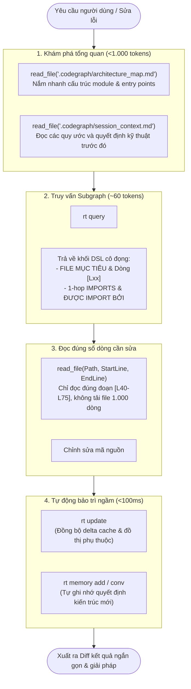

# ReduceToken

**[English](README.md)** | **Tiếng Việt**

Đồ thị tri thức mã nguồn (Code Knowledge Graph) và Bộ nhớ phiên làm việc bền vững (Persistent Session Memory) siêu nhẹ, hoàn toàn tự động dành cho các AI Coding Agent, tuân thủ tiêu chuẩn mở [Agent Skills](https://agentskills.io). Tương thích hoàn hảo với **Google Antigravity**, **Cursor IDE**, **Claude Code**, **OpenCode**, **Codex**, và **GitHub Copilot**.

[](LICENSE)
[](https://www.python.org/)
[](https://docs.python.org/3/library/)
[](https://agentskills.io)
[](https://modelcontextprotocol.io)
[](#-kinh-tế-token-trước-và-sau-khi-dùng-reducetoken)

> **Triệt tiêu hoàn toàn tình trạng phình cửa sổ ngữ cảnh (Context Window Bloat), ngăn chặn hành vi quét toàn bộ thư mục lãng phí (`ls -R`, đọc tràn lan toàn bộ file), và cắt giảm tới 95% lượng token tiêu thụ.**

---

## ⚡ Bắt đầu nhanh (Quick Start)

> **Bạn chỉ cần chọn 1 trong 2 cách cài đặt dưới đây:**

### 🌟 Cách A: Trình cài đặt thông minh đa nền tảng (Khuyên dùng)
Cài đặt công cụ dòng lệnh `rt` và tự động phát hiện các AI Agent có sẵn trên máy tính của bạn:

```bash
# 1. Cài đặt CLI trực tiếp từ Git
pip install git+https://github.com/TuilaTammmmm/ReduceToken.git

# 2. Chạy bộ cài đặt thông minh (Tự nhận diện môi trường AI và cho phép chọn cài đặt)
rt install
```

**Giao diện lựa chọn tương tác:**
```text
Detected AI environments on your system:
  [1] Google Antigravity & Gemini CLI        [DETECTED]
  [2] Cursor IDE (Global MCP)                [DETECTED]
  [3] Claude Code                            [DETECTED]
  [4] OpenCode                               [DETECTED]
  [5] Agent Skills Standard (Codex)          [DETECTED]
  [6] Current Project Directory Only (.codegraph/)  [Local]
  -------------------------------------------------------------
  [A] Install for ALL agents (Recommended)
  [Q] Cancel
```
*(Mẹo: Bạn có thể gõ `rt install --global` để tự động cấu hình cho toàn bộ AI mà không cần hỏi lại).*

---

### 📦 Cách B: Cài đặt qua Trình quản lý gói của Agent (Tùy chọn)
Nếu bạn không muốn dùng Python/pip, bạn có thể thêm ReduceToken trực tiếp qua các trình quản lý kỹ năng:

* **Agent Skills CLI**:
  ```bash
  npx skills add TuilaTammmmm/ReduceToken
  ```
* **Codex Marketplace**:
  ```bash
  codex plugin marketplace add TuilaTammmmm/ReduceToken --ref main
  ```
* **OpenCode**:
  ```bash
  # Copy thư mục skill trực tiếp:
  cp -R plugins/reduce-token/skills/reduce-token .opencode/skills/
  ```

---

## 🚀 Kích hoạt trong bất kỳ dự án nào

Sau khi cài đặt, hãy mở terminal tại bất kỳ thư mục dự án nào mà bạn muốn AI tiết kiệm token:

```bash
rt init
```

### 🛡️ Cơ chế "Zero Root Clutter" (Không xả rác thư mục gốc)
* **Tự động nhận diện cấu hình Toàn cục**: Nếu máy bạn đã cài plugin ReduceToken toàn cục (`~/.gemini/config/plugins/reduce-token` hoặc `~/.agents/`), lệnh `rt init` sẽ **chỉ tạo duy nhất thư mục ẩn `.codegraph/`**. Tuyệt đối không sinh thêm các file rule rải rác ngoài thư mục gốc dự án.
* **Đóng gói thư mục ẩn chuẩn hóa**: Nếu máy chưa cài plugin toàn cục và cần tạo rule cục bộ, hệ thống sẽ gom gọn gàng vào:
  * `.agents/rules/token-saver.md` (chuẩn Agent Skills dành cho Antigravity, OpenCode, Codex).
  * `.cursor/rules/token-saver.mdc` (dành riêng cho Cursor IDE).
  * `.github/copilot-instructions.md` (chỉ tạo khi thư mục `.git` và `.github` đã tồn tại).

### ⚙️ Các tùy chọn CLI linh hoạt:
* `rt init`: Chế độ tự động thông minh, sạch sẽ và an toàn.
* `rt init --clean` (hoặc `-c`): Chế độ sạch tuyệt đối, chỉ sinh duy nhất thư mục `.codegraph/`.
* `rt init --agent <tên>`: Chỉ định chính xác công cụ AI muốn cấu hình (`antigravity`, `cursor`, `claude`, `copilot`, `none`, `all`).
* `rt init --root-rules`: Tùy chọn sinh file rule trực tiếp ở thư mục gốc (dành cho người dùng muốn theo phong cách cũ).

---

## 🔄 Cách cập nhật phiên bản mới

Khi có tính năng mới hoặc bản sửa lỗi, bạn có thể nâng cấp mọi thứ chỉ với **1 câu lệnh duy nhất**:

```bash
rt upgrade
```
*Lệnh này sẽ tự động kéo bản cập nhật mới nhất từ Git qua pip VÀ đồng bộ lại toàn bộ plugin của các AI Agent (Antigravity, Cursor, Claude Code, OpenCode, Codex).*

*(Hoặc nâng cấp thủ công qua pip: `pip install -U git+https://github.com/TuilaTammmmm/ReduceToken.git && rt install --global`)*

---

## 🎯 Các tính năng cốt lõi & Ví dụ câu lệnh

| Kỹ năng / Tính năng | Mô tả | Câu lệnh mẫu cho AI Agent |
|---|---|---|
| **Truy vấn Subgraph mục tiêu** | Định vị chính xác vị trí symbol, số dòng code và các file phụ thuộc 1-hop chỉ tốn ~60 tokens | *"Tìm nơi định nghĩa `AuthManager` và xem những file nào đang gọi nó."*<br>*"Định vị hàm xử lý route `/api/v1/checkout` mà không cần quét toàn bộ thư mục."* |
| **Khám phá Kiến trúc dự án** | Cái nhìn toàn cảnh chim bay (bird's-eye) về toàn bộ module, điểm khởi chạy và cụm thư mục (<1.000 tokens) | *"Cho tôi bản đồ tổng quan kiến trúc của dự án này."*<br>*"Module nào chịu trách nhiệm xác thực token và quản lý database?"* |
| **Bộ nhớ phiên làm việc bền vững** | Ghi nhớ lâu dài các quyết định kiến trúc và quy ước code qua các phiên chat (~150 tokens) | *"Lưu quyết định chuyển sang dùng WebSocket thay vì polling vào bộ nhớ dự án."*<br>*"Thêm quy ước code: Mọi biến tọa độ đều phải tính theo đơn vị milimet."* |
| **Nén bộ nhớ (Compaction)** | Tóm tắt các quyết định và cập nhật ngữ cảnh cô đọng trước khi mở tab chat mới | *"Hãy cô đọng bộ nhớ phiên để chúng ta bắt đầu một tab chat mới thật nhẹ nhàng."* |
| **Tự động đồng bộ ngầm** | Kiểm tra chênh lệch (delta check) siêu tốc (<10ms) và cập nhật đồ thị khi có file thay đổi | *"Hãy tái cấu trúc middleware xác thực."* *(AI sẽ tự động chạy đồng bộ ngầm mà không làm phiền bạn).* |

---

## 🔄 Quy trình hoạt động tự động của Agent (Zero-User-Effort)

ReduceToken hoạt động theo một vòng lặp tự động khép kín, **người dùng không cần can thiệp**:



### Mẫu đầu ra Agent DSL cô đọng
Khi Agent tra cứu một symbol, nó nhận được một khối ngữ cảnh cực ngắn gọn:
```text
=== REDUCETOKEN SUBGRAPH (Compact Context) ===
TARGET FILE: src/auth/jwt.py
DEFINES: class AuthManager() [L12], function verify_token() [L42]
IMPORTS (1): src/config.py
IMPORTED BY (2): src/api/middleware.py, src/routes/user.py
RECOMMENDED ACTION: Read only 'src/auth/jwt.py'. Do NOT read entire directory.
==============================================
```

---

## 📊 Kinh tế Token: Trước và Sau khi dùng ReduceToken

| Thao tác | Hành vi truyền thống của Agent | Khi có ReduceToken | Mức độ tiết kiệm Token |
| :--- | :--- | :--- | :--- |
| **Định hướng dự án mới** | Quét toàn bộ thư mục (`ls -R`, đọc nhiều file) (~8.000 tokens) | Đọc `architecture_map.md` (~900 tokens) | **~88%** |
| **Tìm một Symbol / Hàm** | Grep toàn bộ repo & đọc 5–10 file (~12.000 tokens) | Truy vấn Subgraph DSL (~60 tokens) | **~99%** |
| **Đọc mã nguồn** | Tải toàn bộ file 500–1.000 dòng (~2.500 tokens) | Đọc đúng phạm vi dòng qua `[Lxx]` (~150 tokens) | **~94%** |
| **Mở phiên Chat mới** | Nạp lại 20+ lượt hội thoại cũ (~15.000 tokens) | Đọc `session_context.md` (~150 tokens) | **~98%** |
| **Tổng trung bình mỗi tác vụ** | **~37.500 tokens** | **~1.260 tokens** | **~96.6%** |

---

## 🇻🇳 Bảo tồn ký tự Tiếng Việt (UTF-8 Native)

ReduceToken hỗ trợ xử lý mã nguồn đa ngữ và tiếng Việt có dấu toàn diện:
* Tất cả các file xuất dữ liệu (`symbols.json`, `graph.json`, `cache.json`, `memory.json`) được cấu hình mặc định `ensure_ascii=False`.
* Toàn bộ docstring, chú thích (comments), tóm tắt module tiếng Việt được lưu giữ nguyên bản có dấu:
  ```json
  "summary": "HỆ THỐNG QUẢN LÝ KHO DƯỢC PHẨM (Dùng Tkinter)",
  "doc": "Lớp cha cho mọi lỗi nghiệp vụ trong quản lý kho."
  ```
* **Lợi ích**: Không bị mã hóa dạng chuỗi `\uXXXX`, giúp con người dễ dàng đọc hiểu file cấu hình và **tiết kiệm thêm ~40–60% token** cho AI khi xử lý các đoạn văn bản tiếng Việt.

---

## 📂 Cấu trúc Repository & Thư mục sinh ra

```text
ReduceToken/
├── plugins/
│   └── reduce-token/          — Bundle Plugin toàn cục cho Antigravity & Gemini CLI
│       ├── plugin.json        — Manifest ("displayName": "ReduceToken")
│       ├── mcp_config.json    — Cấu hình MCP Server tích hợp
│       ├── rules/AGENTS.md    — Quy tắc tiết kiệm token tự động
│       └── skills/
│           └── reduce-token/
│               ├── SKILL.md   — Hướng dẫn cốt lõi (Mission Control)
│               ├── references/— Tài liệu tham khảo sâu (DSL, Aliases, Memory)
│               └── examples/  — Luồng ví dụ thực tế cho Agent
├── .agents/
│   └── skills/reduce-token/   — Đường dẫn khám phá chuẩn Agent Skills
│       └── SKILL.md
├── reducetoken/               — Động cơ lõi (Thuần Python, 0 dependency ngoài)
│   ├── parsers/               — Bộ phân tích Python AST, JS/TS, và generic
│   ├── scanner.py             — Bộ quét file & ignore tốc độ cao
│   ├── graph.py               — Đồ thị phụ thuộc có hướng & Resolve Path Alias
│   ├── cache.py               — Bộ đệm delta SHA-256 & Nhận diện Git HEAD
│   ├── generator.py           — Bộ sinh bản đồ kiến trúc & DSL cho Agent
│   ├── memory.py              — Quản lý bộ nhớ phiên làm việc lâu dài
│   ├── mcp_server.py          — Native Model Context Protocol (MCP) server
│   └── cli.py                 — Giao diện dòng lệnh (`rt`, `reducetoken`)
├── .codegraph/                — Thư mục tri thức mã nguồn (Theo dõi bằng Git)
│   ├── architecture_map.md    — Tổng quan cấu trúc kiến trúc (<1.000 tokens)
│   ├── session_context.md     — Quy ước kỹ thuật & quyết định kiến trúc (~150 tokens)
│   ├── symbols.json           — Chỉ mục symbol, số dòng [Lxx], docstrings
│   ├── graph.json             — Đồ thị phụ thuộc chi tiết giữa các file
│   └── cache.json             — Bộ đệm delta trên máy cục bộ
├── setup.py                   — Điểm phân phối gói (`rt`, `reducetoken`)
├── README.md                  — Tài liệu tiếng Anh
└── README_VI.md               — Tài liệu tiếng Việt
```

---

## 🛠️ Bảng tra cứu câu lệnh CLI

Bạn có thể sử dụng alias ngắn **`rt`** (hoặc `reducetoken`) ở bất kỳ đâu trong terminal:

| Câu lệnh (`rt` hoặc `reducetoken`) | Ý nghĩa / Hành động |
|---|---|
| `rt init [--clean] [--force]` | Quét dự án, xây dựng `.codegraph/` (tự động nhận diện cấu hình toàn cục, không làm bẩn root) |
| `rt upgrade` | **Tự nâng cấp** phiên bản mới nhất từ Git và đồng bộ toàn bộ AI agent |
| `rt query <symbol_hoặc_file>` | Tra cứu vị trí chính xác của symbol, số dòng và quan hệ phụ thuộc |
| `rt update` | Đồng bộ lại các file vừa chỉnh sửa (<100ms) |
| `rt overview` | In nhanh bản đồ kiến trúc toàn dự án |
| `rt memory add "<Chủ đề>" "<Nội dung>"` | Ghi nhớ một quyết định kiến trúc vào `session_context.md` |
| `rt memory conv "<Quy ước>"` | Ghi nhớ một quy ước lập trình cho các phiên chat sau |
| `rt compact` | Tóm tắt và nén lại bộ nhớ phiên làm việc |
| `rt install [--global]` | Cài đặt plugin toàn cục cho các AI Agent trên máy |
| `rt mcp` | Chạy dưới dạng Native Model Context Protocol (MCP) server |
| `rt git-hook` | Cài đặt Git hook `post-commit` để tự động đồng bộ đồ thị sau mỗi commit |

> **💡 Gợi ý**: Cả hai alias `rt` và `reducetoken` đều được đăng ký tự động trên toàn hệ thống.  
> **Cách chạy dự phòng không cần alias**: `python -m reducetoken.cli <câu_lệnh>`.

---

## 🔌 Tích hợp Model Context Protocol (MCP)

ReduceToken tích hợp sẵn một MCP Server hiệu năng cao để kết nối trực tiếp với các Agent hỗ trợ MCP (Antigravity, Claude Desktop, Cursor, OpenCode):

```json
{
  "mcpServers": {
    "reducetoken": {
      "command": "python",
      "args": ["-m", "reducetoken.cli", "mcp"]
    }
  }
}
```

### Các công cụ MCP cung cấp:
* `get_architecture_map`: Trả về cấu trúc tổng thể và các điểm khởi chạy của dự án.
* `query_code_graph`: Trả về khối Subgraph DSL siêu gọn cho bất kỳ symbol hoặc đường dẫn file nào.
* `get_session_memory`: Đọc các quy ước và quyết định kiến trúc từ `session_context.md`.
* `add_memory_decision`: Ghi nhớ quyết định hoặc quy ước mới trực tiếp vào bộ nhớ dự án.

---

## 🌐 Các ngôn ngữ lập trình được hỗ trợ

* **Python**: Phân tích AST toàn diện (`ast`), nhận diện class, method, function, decorator, docstring và resolve module dot-import.
* **JavaScript / TypeScript**: Phân tích regex tốc độ cao theo chuẩn AST, hỗ trợ ESM imports, CommonJS `require`, class, arrow function, export và **Path Aliases** (`tsconfig.json paths` `@/*`, `~/*`).
* **Go, Rust, Java, C/C++, C#, PHP, Ruby, Swift, Kotlin, v.v.**: Bộ phân tích cấu trúc tổng quát trích xuất symbol và quan hệ phụ thuộc.

---

## 📄 Giấy phép mã nguồn mở (License)

Phát hành dưới giấy phép [MIT License](LICENSE). Bản quyền (c) 2026 TuilaTammmmm (ReduceToken). Hoàn toàn miễn phí cho mục đích cá nhân và thương mại.
